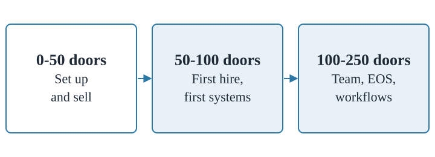
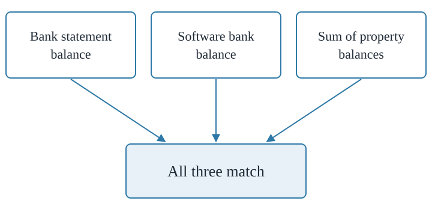
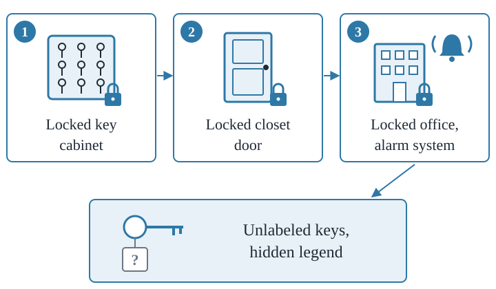

My property management company does over $3.5 million in revenue and manages over 700 doors. If I were starting over today, this is the exact order I'd build it in.

When I got started, there was nothing. No YouTube videos, no courses, no Crane. I didn't grow up in real estate, nobody in my family was in the business, and I'd never worked at a PM company. So I figured it out the hard way and made a bunch of mistakes. This is the guide I wish I'd had.

It's for anyone starting from zero, or sitting somewhere around 50 to 100 doors and wondering what comes next. It's broken into three stages: **0-50 doors: set up and sell.** **50-100 doors: first hire, first systems.** **100-250 doors: team, EOS, workflows.**

*The three stages, and the main job in each one.*

## What you'll learn

- Get licensed, incorporated, and banked with a trust account and an operating account
- Pick a business name and domain you won't regret (I regret mine)
- Find your first clients through realtor and investor networking
- Run a monthly triple tie-out on your trust account
- Know when to hire your first employee, maintenance tech, and remote team member
- Put the systems in place (forms, shared inboxes, workflow software, Slack) that let you scale past 250 doors

## Set up the business the right way {t=02:22}

> [!TAKEAWAY]
> Before you take your first client, get licensed, incorporate, open two bank accounts, and lock down your agreements and your domain. All of it is harder to fix later.

Some of these you already know. I'm guessing a few you haven't thought about.

### Get licensed

Find out whether your state requires a license to manage rental property. Most states require you to be a licensed real estate broker, or to work under the supervision of one, to manage homes you don't own (third-party property management). Look it up, then confirm the details with an attorney in your state who knows these laws. They can help with your documents too.

State regulators take this very seriously. If you're caught managing without a license in a state that requires one, the consequences are serious.

In some states, a broker's license is hard to get. In Ohio it takes a lot of experience, so I started with my salesperson's license and worked under a broker for my first two years while I built up the transactions I needed. Nothing wrong with that. Find a broker who'll give you a reasonable split (they take a cut of your revenue in exchange for the framework that lets you operate legally) and work out the details.

### Get an office

Working from home is great, but when you're starting a PM business I recommend some kind of office: a co-working space or a small office, ideally close to where you'll manage. Some states require it, some don't. Having a physical presence with your name on the door says a lot about how seriously you take the business. Residents notice it when they pick up keys. Owners notice it when they come in to meet you.

### Incorporate and open two bank accounts

1. **Incorporate.** You'll likely want an LLC, but I'm not a tax accountant and this varies by state.
2. **Open a trust account.** This is where owner and tenant funds that don't belong to you go.
3. **Open an operating account.** This is where your company's money sits. When you collect management fees or leasing fees, you move them from the trust account to the operating account.

### Write your two key documents

Your **property management agreement** (between you and the owner) and your **lease agreement** (typically between your company and the resident; in some states, between the owner and the resident).

The PMA says what property you'll manage, for what dates, for how much per month, and exactly what is and isn't your responsibility. The lease covers the start and end dates, rent, late fees, and the rest. The attorney you talk to about licensing may be able to help, and there are plenty of templates online to start from. They don't have to be perfect on day one. They'll evolve.

### Set up your digital home

Pick your domain carefully, because it's very, very difficult to change later. You'll say it constantly: your email address, business cards, marketing materials. It should be easy to type and easy to say over the phone.

- **Get a .com.** Not .org, .co, or .biz.
- **One or two words.** The shorter the better.
- **Acronyms: four letters or fewer.**
- **No dashes.**
- **Check domain availability before you settle on a business name,** so the two work together.
- **Spend a little money if you have to.** If the domain you want is available for something like $300, just buy it.

I regret my company's name. It's RL Property Management Group, and the only domain we could get was rlpmg.com. That's five letters. It's too many, it's hard to say, it's awkward, and people mistype it.

Once you have the domain, sign up for Google's business suite so you get email at your domain plus Google Sheets and Docs. Use something like your first name at your company domain. You don't want to operate from a gmail.com address when you're asking people to trust you with millions of dollars of rental real estate.

Then set up your **Google Business Profile**: your address, business hours, directions to your office, and reviews. They may mail you a postcard to verify it. Do it early. The sooner you start building authority and reviews, the sooner you climb the organic search results.

## Network your way to the first clients {t=09:14}

> [!TAKEAWAY]
> Your first clients come from showing up, in person and consistently, everywhere realtors and investors gather. Every conversation is sales, so treat it that way.

You won't get much website traffic yet. You can spend on digital marketing, but there's lower-hanging fruit in your city.

1. **Build your event list with AI.** Ask it for two lists: every realtor meetup in your metro, and every real estate investor meetup. Have it check meetup.com and local realtor sites. You'll be amazed how many events happen every single week.
2. **Show up.** Look nice, smile, introduce yourself: "Hey, I'm Peter. I just started a property management business. What do you do?" Ask about them. That's how you get them interested in you.
3. **Bring business cards.** It sounds old school, but realtors still use them.
4. **Follow up.** Email after the event: great to meet you, enjoyed hearing about your business, here's a little about me in case it's ever helpful for you or your clients.
5. **Keep going.** Momentum takes a while. Showing up consistently tells people you're trustworthy and likely to do a good job with their properties, or their clients' properties.

You'll meet investors who need a PM, and investors who know investors who need one. Realtors are always looking for good property managers to refer clients to, and so is everyone else who touches a real estate transaction: title attorneys, transaction lawyers, bankers, brokers, tax accountants. You can set up paid referral deals, but early on you don't really need to. People just like referring their clients to competent professionals.

### You're in sales now

When you talk to a prospective owner, or even a potential referral partner, you're a salesperson. Sales is very important to owning and growing a business. I'm not a natural salesperson (I'm an engineer by background), so I read a lot of books, watched a lot of videos, and failed a lot. Take it seriously. Every prospect might become one door, or a referral source that leads to hundreds.

Read up on sales, and start tracking contacts and prospects digitally. A spreadsheet or Google Sheet is fine to start. A real CRM comes later.

## Pick software and get insured {t=12:51}

> [!TAKEAWAY]
> At 20, 50, or 100 doors, which PM software you pick won't make or break you. Picking one and using it for everything will.

### Property management software

The five main options residential PMs look at when starting out:

- **Buildium.** It's what I use. It worked great as I scaled. As we push past 1,000 doors it's getting a little creaky in spots.
- **AppFolio.** Has a 50-door minimum. Under 50, you can talk to them, but they probably won't let you join.
- **Propertyware**
- **Rent Manager**
- **Rentvine.** A newer entrant (they've been around a while now), known for customer support and an open API, which I'm a big fan of.

I'm not here to tell you which one to use. Pick one, start using it, and do as much as you possibly can inside it. Learn the ins and outs. You'll be glad you did.

### Insurance

Less glamorous, extremely important. Get these coverages in place (some roll up under one policy):

- General liability
- Errors and omissions (E&O)
- Cyber, because your software and servers hold a lot of sensitive data
- Employee dishonesty, which covers you if an employee steals from you, lies to you, or takes money from a client
- Employment practices
- Tenant discrimination

Talk to insurance brokers and ask around. These are the coverages I think every PM company should have.

## Build reps on core processes and tie out your trust account {t=15:07}

> [!TAKEAWAY]
> Learn how leasing, rent collection, and maintenance work at your company, and reconcile your trust account every month with a triple tie-out.

### Your three core processes

The three main functions of a property manager are **leasing, rent collection, and maintenance.** From 0 to 50 doors, your job is to build reps: how each one works, how they fit together, and how you like them done.

No fancy checklists or process software yet. Just start thinking in departments and write a little down. What's the late fee? How do I handle evictions? What happens when someone calls in a maintenance request? How do I turn a vacant unit and get it ready to rent?

### The triple tie-out

Your trust account is where rent gets deposited, where you typically hold security deposits, and where owner contributions live. (Some states require a separate trust account for security deposits. Ohio doesn't, so ours is all one account.)

Normal reconciliation links the transactions on your bank statement to what your software thinks happened in that account. When you mark rent received in your PM software, when did it actually hit the bank? If a deposit shows up in one place and not the other, it gets flagged, investigated, and hopefully corrected. (Your operating account works the same way, tied out against something like Xero or QuickBooks.)

A **triple tie-out** adds one more check: your rent roll. Take every individual property account (123 Main Street, 456 Main Street) and what the software thinks each balance should be. Add them all up. Three numbers have to match:

1. The **bank statement balance**
2. The **software bank balance** (what your PM software says is in the account)
3. The **sum of property balances**

*If all three match, the money is where it should be.*

Do this every single month. It's the first thing an auditor looks at, and it's where I see property managers lose tens or even hundreds of thousands of dollars. They don't reconcile as they go, they miss owner balances sliding way into the negative, the owner leaves, and they never hear from them again. And that owner owed them $50,000. Very, very possible.

It's hard to explain in a video. If you don't have an accounting background (I don't), work with a professional accounting team or service to get on a monthly reconciliation cadence. It'll help you sleep at night.

> [!WARNING]
> - Skipping monthly trust account reconciliation. It's the first thing an auditor checks.
> - Missing owner balances that go negative until the owner leaves owing you money.

## Hire your first team member and join NARPM {t=19:10}

> [!TAKEAWAY]
> Hire your first employee earlier than you feel ready, somewhere around 50 to 70 doors. Then join NARPM and get to the conferences.

> [!STAT] 50-60 | Doors per full-time employee at most PM companies

Congrats if you've made it here. Many property managers never make it past 50 doors.

### Hire before you feel ready

As a general rule of thumb, most PM companies need one full-time employee for every 50 to 60 doors. It varies with your property types, how competent your people are, what you do for owners, and how much you outsource.

Around this stage, a mentor pushed me hard to hire my first employee. I was scared. I didn't know if I could afford it. I'd never been a boss. I didn't know how to find someone or how to pay them. He told me I could figure it out, that I needed help, and that I had to stop spending so much time on low-value work: showings, processing applications, answering the phone.

I'm glad he did. Hiring before I felt ready pushed me to grow as an entrepreneur, and I learned things about working with employees early that served me for the rest of my career.

So if you're around 50, 60, or 70 doors, bring someone into the office, boots on the ground, for things like:

- Greeting people at the front door
- Handling the mail
- Rental showings
- Answering phones and prospective tenant emails
- Processing rent payments

There are more resources than ever on hiring, interviewing, onboarding, training, and payroll. Don't be afraid.

### Join NARPM

NARPM (the National Association of Residential Property Managers) is your professional trade group. If you know realtors belong to the National Association of Realtors, NARPM is that, for property managers. (We're kind of way better.) I didn't find it until much later than 50 or 60 doors, and it definitely slowed me down.

Membership is very affordable, and it instantly plugs you into a community of PM business owners: conferences, possibly a local chapter, and resources. There are two big national conferences, **Broker/Owner** in the spring and **NARPM National** in the fall. As a business owner you're eligible for Broker/Owner, and I recommend it. They move around the country, so check the website for dates.

Show up, go to the sessions, hang out afterward, rub elbows. It'll accelerate your learning faster than you'd believe, and being able to text someone who's been through the problem you're facing is incredibly valuable.

## Add software slowly and put yourself on payroll {t=23:01}

> [!TAKEAWAY]
> Use what's built into your PM software before you add anything. And pay yourself a reasonable salary through payroll, even as a one-person company.

### Be slow and deliberate with software

Anything you do day to day, there's software for: listings, applications, showings, maintenance requests, accounting, photography. Walking the NARPM trade show floor is a great way to learn what's out there.

But don't add too much too fast. Platforms like Rentvine, Buildium, and AppFolio get more capable by the day. If yours has the function built in, explore that first. Only look elsewhere when it doesn't meet your needs, because every tool you add brings:

- More expense
- Data moving back and forth between systems
- More opportunity for errors
- More to train team members on and keep up with

That doesn't mean it's not worth it. We use a lot of software at my company. Just think carefully before you start adding it willy-nilly.

### Set up payroll

Sign up for payroll software. I use Gusto at my company. Get it set up and compliant with your state's requirements for paying employees, including workers' comp and the other coverages that come with full-time W-2 employees.

### Pay yourself a reasonable salary

Set up payroll for yourself, as a W-2 employee, at a reasonable number. Two reasons:

1. **It may be an IRS requirement.** If you're an S corp, you have to pay yourself a reasonable salary. If you don't, you can end up owing a lot in back taxes and fees.
2. **It keeps your financials honest.** If you pay yourself nothing, or less than the job is worth, your income statement won't show what it would cost to replace you.

"Replace myself? What are you talking about?" Not yet. But eventually you may want someone to run the business. That's what I did. I work in my business less than five hours a week, because I brought in well-paid managers and eventually a president who runs it. Because I'd paid myself a reasonable salary all along, I priced my services to stay profitable with that salary on the books. When it was time to replace myself, I lowered my salary and the money was already there for the new hire.

## Lock down keys and route everything through forms {t=26:18}

> [!TAKEAWAY]
> Keep keys behind three locks with no addresses on them, and send every incoming request through a digital form instead of a general inbox.

### Key security

I mean the physical keys to every home you manage. **Keys should be triple locked.**

At our office in Columbus, Ohio:

1. **Locked key cabinet.** Racks and racks of keys inside (it looks kind of cool, actually).
2. **Locked closet door.** The cabinets sit in a shallow closet with its own lock.
3. **Locked office, alarm system.** The office is locked every night and has a security system.

One more layer: **unlabeled keys, hidden legend.** The key tags have numbers, not addresses. The legend that matches numbers to addresses is hidden and available only to certain employees. If someone defeated all three locks and ripped a cabinet off the wall, they'd have a pile of useless keys.

*Three locks, then keys that are useless to anyone who gets through them.*

There are horror stories of PM companies getting robbed and homes broken into with the stolen keys. That's scary and a big legal liability. Think about who has keys to your own home, and how you'd feel if random employees at the plumbing company you hired had access while your family slept. Order the cabinet, set up the locks, and sleep a little better.

### Forms

Digital forms are the backbone of a property management business. Move-out requests, applications, adding a pet, complaints, "I want to learn about your management services." Every one of those should go to a specific form, not a generic email address or contact page.

Forms do two things:

1. **They force complete information.** A move-out form with required fields captures the move-out date, address, name, and best contact info. Without required fields, you'd be surprised how many people just write "move out 123 Main Street." Which tenant? What day? Their phone number doesn't work anymore.
2. **They route the request to the right person.** You know who processes move-outs, so the move-out form goes straight to them instead of a receptionist or catch-all inbox.

We have about a hundred forms at my company, mostly through JotForm. Google Forms works, other big form providers work, and you could even vibe code your own. The principle: **standardize the inputs to your business.** The more standardized the information coming in, the easier, faster, and less error-prone it is to process. The earlier you get on the forms train, the more time you save over the life of your business.

## After-hours calls, referral deals, and a shared inbox {t=30:38}

> [!TAKEAWAY]
> Decide how after-hours emergencies get handled, start trading paid referrals with other PMs and realtors, and move outside communication into a shared inbox before it gets harder.

### After-hours maintenance

A lot of maintenance comes in on weekends or in the middle of the night. Your options:

- **Handle it yourself** (and answer every unknown call that might be a tenant)
- **Have someone on your team handle it**
- **Use an AI voice solution.** There are AI voice tools for property managers that take calls after hours or during business hours.
- **Use an after-hours emergency answering service** built for property managers. They decide whether it's a real emergency and can call a vendor and dispatch someone in the middle of the night.

People used to say the only true emergencies were "fire, flood, and blood." It's more nuanced than that. In a cold climate like Ohio, pipes freeze and burst, and water leaking into a home is an emergency.

There's no single right way. Just get something in place, tell your tenants exactly what to do in an emergency, and set your phone system to give after-hours callers an option, like "If this is a maintenance emergency, press 8," that routes them where they need to go.

### Referral agreements, both directions

By now your networking should be paying off. Referrals can run two ways:

- **You pay for referrals.** When a realtor or another PM sends you a client who signs a management agreement, you might pay them $100, $200, $300, or $500 as a thank-you and an incentive to send more. This is generally legal as long as the other person is licensed in your state.
- **You get paid for referrals.** You'll start getting leads for properties you don't want to manage. Find PMs in your area who are happy to take them, get an agreement signed, and log every referral in a Google Sheet. About once a quarter, ask which ones became customers and send an invoice. It's a great way to make money on properties you never manage.

### Set up a shared inbox

You're probably handling incoming email in your personal work address (for me, peter@ my business domain), and your team may be doing the same. Set up a shared inbox, something like info@ or owners@ your company domain. One or two at most, maybe one for owners and one for tenants. All external communication, incoming and outgoing, goes through it.

There will be a transition period while you, your team, your owners, and your tenants get used to it. **The longer you wait, the harder the switch.** It matters because the business has to keep running when someone quits or you go on vacation, and a shared inbox lets everyone see every conversation with people outside your four walls. Shared inboxes are what let you scale to 500 doors and beyond.

You can work straight out of Gmail for now. Shared inbox products like LeadSimple supercharge this, and they're worth a look.

> [!NOTE]
> Add a property management podcast or two to your rotation for walks, drives, and dishes. I have one, and there are plenty of good ones. Listen once a week to keep learning and stay plugged into the broader PM community.

## Past 100 doors: maintenance techs, RTMs, and EOS {t=35:55}

> [!TAKEAWAY]
> After 100 doors, consider your first in-house maintenance tech and your first remote team member, and read Traction.

> [!STAT] 100 | Doors per full-time in-house maintenance tech

Many property managers never crack 100 doors. Congratulations.

### Your first in-house maintenance tech

Some PMs rely entirely on third-party vendors, and that's okay. We run in-house maintenance at RL Property Management with eight or nine full-time W-2 techs at any given time, and the maintenance division alone will do easily over a million dollars this year.

If that appeals to you, this is when you can bring on your first tech. You can support about one full-time maintenance technician for every 100 doors. How to do it well is a whole other video.

### Your first remote team member (RTM)

An RTM is someone who works outside the United States on your business. Some people call them VAs. We don't, because they're way more than assistants. At our company they're full-time, full-fledged team members, some with high levels of responsibility.

RTMs are a very affordable way to grow headcount for work that doesn't need boots on the ground. You can't send an RTM to show a property, unlock a door, or meet a vendor. But a lot of PM work is people at computers and on phones, and you can find extremely capable people in Mexico, the Philippines, Guatemala, Nicaragua, and elsewhere, at a fraction of US salaries.

Agencies will place this talent for you, in some cases already trained on your software. Crane members get access to a partnership that makes this extremely affordable. VPM Solutions is another, and if you walk any NARPM vendor hall you'll find half a dozen or more. Most PM companies operating at scale have at least part of their workforce as RTMs.

### EOS

Gino Wickman created EOS, the Entrepreneurial Operating System. His book *Traction* is basically the bible for it. It's an operating system for small businesses, and it happens to work very well for property management. Half or more of the most successful PM businesses I know run on EOS, including ours.

Step one: get *Traction* (ebook, audiobook, or paper) and read it cover to cover.

If you're just hitting 100 doors, it may bounce off you because it isn't solving problems you have yet. Reread it as you pass 150 to 200 doors. As you add headcount and scale, it will speak directly to the problems you're starting to face.

## Workflow software and team communication {t=40:05}

> [!TAKEAWAY]
> Document your six to 10 core workflows in workflow software so they happen the right way every time, and give your growing team Slack with clear norms.

> [!STAT] 6-10 | Core workflows most PM companies run multiple times a week

As you approach 250 doors, you'll have two, three, four, five team members. You're a manager and a leader now, not a solopreneur with a side hustle. Real businesses need real workflow solutions.

### Workflow software

Your core workflows are the things you do over and over, every week: move-ins, move-outs, lease renewals, new owner onboardings. Most companies have around six to 10 of them, and they have to happen the right way, the same way, every time.

Maybe you've been running them from memory, and your people can do them with their hands tied behind their backs. But as you add new people, the complexity and the number of tasks grow a lot. Workflow software is where you document each process once. Every time the job comes up, you start a new instance, and it guides your team through every step (sometimes completing steps automatically).

Two things I love about it:

- **You can see the state of every open process.** You might have 8 to 10 lease renewals in flight. You just started outreach to the tenant on one, you're prepping another for e-signature, and a third is waiting on the owner to approve the new rent. Without a system you forget where 123 Main Street stands, and balls get dropped. Workflow software shows every one, its status, what you're waiting on, and anything overdue.
- **You can assign tasks to specific people.** A lease renewal can route sending the lease to Tammy, owner approval to you, and filing the signed lease to Stephanie, automatically, instead of handing the whole thing to one person and hoping they finish it.

### Team communication

Most people use Slack. If you aren't already, this is when it starts to make sense. Set up a couple of channels, get the whole team on it, and set guidelines:

- **Everyone sets a profile picture.** Especially with a distributed team and RTMs, it makes a real difference to company culture.
- **Define your reaction norms.** Thumbs up when we agree? Check mark when something is done?
- **Decide on threads.** Are conversations threaded?
- **Decide what goes where.** What belongs in Slack versus a phone call versus an email?

Have it running before you onboard your next team members.

### Keep learning

Sign up for a few industry newsletters. I write one, but I'm not the only one. They'll keep you current on conferences, new software, lawsuits, and best practices. And once you're over 150 doors, Crane is my private community for PM business owners helping each other grow faster, with the goal of time freedom. I take a month off every June. When you can do that, you no longer own a job. You own a business.

## Resources mentioned

- [NARPM](https://www.narpm.org/) (Broker/Owner in the spring, NARPM National in the fall)
- [Crane](https://joincrane.co/), my private community for PM business owners over 150 doors. It opens to new members once or twice a year, typically spring and fall.
- [My newsletter](https://www.peterlohmann.com/newsletter), every Tuesday and Friday
- *Traction* by Gino Wickman (EOS)
- Property management software: Buildium, AppFolio, Propertyware, Rent Manager, Rentvine
- Gusto (payroll)
- JotForm or Google Forms (digital forms)
- LeadSimple (shared inbox)
- VPM Solutions (remote team members)
- Slack (team communication)
